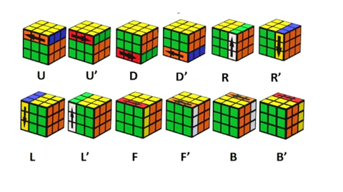

# Virtual-Rubik's-Cube

## Demo

Here’s a short [demo video](https://youtu.be/Jz55aOi56Hc) showcasing the key features and functionality of the application. 
As a fun bonus, the end of the video includes a clip of me solving a physical Rubik’s Cube.

## Instructions

* Ensure that you're running Python 3.11 (the pinned numpy and vpython versions don't support newer Pythons)
* Create a virtual environment and install the requirements in requirements.txt. Please note that in order to install the kociemba library, a C compiler is required.
  ```bash
  python3.11 -m venv .venv
  .venv/bin/pip install -r requirements.txt
  ```
* Execute the “run_program.py” file to initiate the program (`.venv/bin/python run_program.py`), launching the VPython window in your browser featuring a 3x3 Rubik's cube along with the control buttons below. Press Ctrl+C in the terminal to stop it.

## Controls

**Mouse**
- **Drag a tile** (left-click and hold, then move the mouse) to turn the row or column you grabbed in that direction. 
- **Rotate the view** by holding the right mouse button and moving the mouse. It turns freely in any direction.
- **Zoom** with the scroll wheel while the mouse is over the black box.
- **Resize** the black box by dragging its edges or corners.

**Buttons**
- **F R B L U D** (and their primes) turn a layer, **x y z** rotate the whole cube.
- **scramble** mixes up the cube.
- **reveal solution / hide solution** shows or hides the moves that solve it.
- **solve cube** plays the solution for you.

## Cube Notation
For those unfamiliar with cube notation, please reference the image below:



Each letter corresponds to a specific move or rotation on a Rubik's Cube. These moves are as follows:

- **U:** Up face
- **D:** Down face
- **L:** Left face
- **R:** Right face
- **F:** Front face
- **B:** Back face

Additional symbols include:
- **' (prime):** Indicates a counter-clockwise rotation
- **2:** Denotes a double turn in the specified direction
- **x, y, z:** Rotate the whole cube, like R, U, and F respectively (x', y', z' go the other way)

